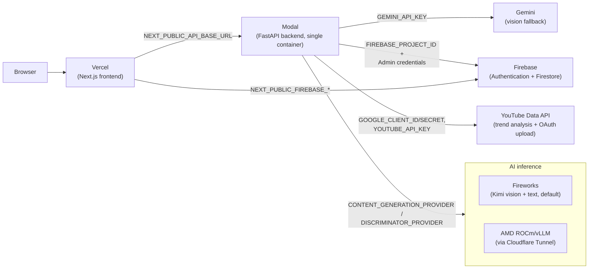

# Deployment

ClipContext is two independently deployable pieces: a Next.js frontend and a
FastAPI backend. This guide covers both, plus the AI inference targets
(Fireworks, AMD vLLM) and the two supporting services (Firebase, YouTube
Data API) they talk to. For everything AMD-specific, see
[AMD.md](AMD.md). For the full environment-variable reference, see
[Environment.md](Environment.md).

## Topology



The frontend never talks to Fireworks, AMD, Gemini, or the YouTube Data API
directly — only the backend does, using server-side keys. The frontend only
talks to the ClipContext backend and, for account login, directly to
Firebase Authentication using the public web config.

## Frontend (Vercel)

The repo is a monorepo: the Next.js app lives in `frontend/`, not the repo
root. In the Vercel project's **Settings → General → Root Directory**, set
it to `frontend`. Without this, Vercel will try to build from the repo root
and fail (the root `package.json` there is just repo metadata, not a
Next.js app — it has no `next` dependency or build script). There is no
`vercel.json` in this repo — Root Directory plus Vercel's automatic
Next.js framework detection is all that's needed; no custom rewrites or
build overrides are required.

Build command (from `frontend/package.json`, Vercel's Next.js preset picks
this up automatically once Root Directory is set correctly):

```bash
npm run build   # → next build
```

Required environment variables, set in the Vercel project's environment
variable manager (not committed — see `frontend/.env.local.example`):

| Variable | Required | Purpose |
|---|---|---|
| `NEXT_PUBLIC_API_BASE_URL` | Yes | URL of the deployed backend, e.g. `https://<modal-workspace>--clipcontext-api.modal.run`. |
| `NEXT_PUBLIC_FIREBASE_API_KEY` | Only for ClipContext account login | Firebase web config. |
| `NEXT_PUBLIC_FIREBASE_AUTH_DOMAIN` | Only for ClipContext account login | Firebase web config. |
| `NEXT_PUBLIC_FIREBASE_PROJECT_ID` | Only for ClipContext account login | Firebase web config. |
| `NEXT_PUBLIC_FIREBASE_STORAGE_BUCKET` | Only for ClipContext account login | Firebase web config. |
| `NEXT_PUBLIC_FIREBASE_MESSAGING_SENDER_ID` | Only for ClipContext account login | Firebase web config. |
| `NEXT_PUBLIC_FIREBASE_APP_ID` | Only for ClipContext account login | Firebase web config. |

Leaving all six `NEXT_PUBLIC_FIREBASE_*` variables unset is a supported
configuration — the core workflow (upload, process, results, YouTube
upload) works without ClipContext accounts. See
[Environment.md](Environment.md) for the full variable list.

**Important gotcha: `NEXT_PUBLIC_*` variables are baked in at build time.**
Next.js inlines every `NEXT_PUBLIC_*` value into the JavaScript bundle
during `next build` — it does not read them from the runtime environment on
each request. Changing a `NEXT_PUBLIC_*` variable in Vercel's dashboard has
**no effect on an already-deployed build**; it only takes effect on the
*next* deployment. If you update `NEXT_PUBLIC_API_BASE_URL` or any Firebase
variable in Vercel, you must trigger a redeploy (a new commit, or
Vercel's "Redeploy" action) for the change to actually reach users.

Also set the backend's `ALLOWED_ORIGINS` to include the deployed frontend's
Vercel origin (see [Environment.md](Environment.md)), or the browser will
be blocked by CORS when calling the backend.

## Backend (Modal)

The production backend runs on [Modal](https://modal.com) via
[`modal_app.py`](../modal_app.py) at the repo root. It serves the exact same
`src.api.app:app` that `make backend` and the [`Dockerfile`](../Dockerfile)
run — there is no Modal-specific business logic anywhere in `src/`.

Why Modal (the backend previously ran on Railway, whose trial expired):

- **It's a real Python container**, not a short-lived JS/edge function: the
  pipeline shells out to ffmpeg, writes job artifacts to local disk, runs
  faster-whisper on CPU, and runs long background jobs in-process. Supabase
  Edge Functions (Deno, small memory/time limits) and stateless Vercel
  Functions can't host this without a rewrite.
- **Free tier that doesn't expire**: Modal's Starter plan includes $30 of
  compute per month, renewed monthly. The container scales to zero when
  idle, so an idle backend costs nothing; a 2-core / 4 GiB container costs
  roughly $0.13 per hour it's actually awake.
- **Memory headroom**: 4 GiB instead of Railway's ~1 GB, which removes the
  faster-whisper OOM problem described below.

### One-time setup

```bash
uv tool install modal          # or: pip install modal
modal token new                # browser login, writes ~/.modal.toml
```

Create the `clipcontext-backend` secret that `modal_app.py` attaches. The
easiest route is a production dotenv file kept **outside git** (never
commit it), then:

```bash
modal secret create clipcontext-backend --from-dotenv path/to/prod.env --force
```

It needs at least `FIREWORKS_API_KEY`, `YOUTUBE_API_KEY`, `GEMINI_API_KEY`
(the process refuses to start without them), plus the production values
below for CORS, YouTube OAuth, and Firebase:

```
ALLOWED_ORIGINS=https://<your-frontend-host>
FRONTEND_URL=https://<your-frontend-host>
GOOGLE_OAUTH_REDIRECT_URI=https://<your-backend-host>/api/youtube/callback
COOKIE_SECURE=true
COOKIE_SAMESITE=none
FIREBASE_PROJECT_ID=...
FIREBASE_SERVICE_ACCOUNT_JSON={...single-line service-account JSON...}
```

Use `FIREBASE_SERVICE_ACCOUNT_JSON`, not `GOOGLE_APPLICATION_CREDENTIALS` —
the credentials file isn't shipped to the container. Re-run the
`modal secret create ... --force` command after changing any value; a
running container keeps its old environment until it restarts (redeploy,
or let it scale to zero).

### Deploy

```bash
make deploy-backend            # = modal deploy modal_app.py
```

The backend URL is stable across deploys:

```
https://<modal-workspace>--clipcontext-api.modal.run
```

Set that as `NEXT_PUBLIC_API_BASE_URL` in Vercel (and redeploy the
frontend — see the build-time gotcha above). Logs: `modal app logs
clipcontext-backend`, or the Modal dashboard.

### `max_containers=1` is required, not optional

`modal_app.py` pins `max_containers=1`, and this is a hard requirement of
the current code, not a cost-saving default. Two pieces of backend state
are process-local, in-memory Python dictionaries with no shared backing
store:

- **The job registry** (`src/api/jobs.py`, `JobRegistry`) — tracks every
  in-flight and completed job's status, stage, and progress, keyed by
  `job_id`, entirely in a `dict` guarded by a `threading.Lock`.
- **The YouTube OAuth session/token/state stores** (`src/youtube/session.py`,
  `src/youtube/token_store.py`, `src/youtube/state_store.py`) — the
  "Connect with YouTube" flow's session cookie binding, stored credentials,
  and CSRF state are all in-memory dicts keyed by an opaque session id.

With more than one container, a client polling `GET /api/jobs/{id}` could
hit a container that never saw the job and get a 404, and a browser
completing the YouTube OAuth callback could land on a container that never
saw the original `state`. Because only one container is allowed,
`@modal.concurrent(max_inputs=100)` lets that container serve concurrent
requests itself, the same way a single uvicorn process does. Keep this
unless shared state (e.g. a Redis/Postgres-backed job registry and token
store) is implemented.

### Scale-to-zero and what it means

The pipeline runs in a background thread started by `POST /api/jobs`; the
container stays alive as long as requests keep arriving, and
`scaledown_window` (20 minutes, Modal's maximum) after the last one. In
practice:

- During processing the frontend polls `GET /api/jobs/{id}` every few
  seconds, which keeps the container warm.
- After ~20 idle minutes the container shuts down. In-memory job state,
  YouTube connections, and the on-disk `outputs/_cache` are lost — the same
  as a restart on any host. The next request cold-starts a fresh container
  in a few seconds.
- A redeploy also replaces the container, with the same effect.

### Memory, and faster-whisper

`modal_app.py` gives the container 2 CPU cores and 4 GiB of RAM. On
Railway's ~1 GB plan, faster-whisper was the stage that got OOM-killed:
`"small"` (~244M params) killed the process outright and even `"base"`
(~74M) did intermittently, which is why `DEFAULT_WHISPER_MODEL_SIZE` in
`src/ai/transcriber.py` is `"tiny"`. With 4 GiB you can set
`WHISPER_MODEL_SIZE=base` or `small` in the secret for better transcripts.
Only `tiny` is baked into the image, so a larger model is downloaded the
first time each fresh container transcribes.

The deferred heavy imports (`pandas`, `scikit-learn`, `firebase-admin` are
imported inside the functions that use them — see `src/trends/`,
`src/firebase/`, `src/artifacts/repository.py`) still keep the boot-time
footprint at ~138 MB, which also shortens cold starts.

If the process ever is OOM-killed on any host, the log shows a bare
**"Killed"** with no Python traceback, followed by the server starting
again. Any in-flight job's `GET /api/jobs/{id}` then returns 404 ("Job not
found") because the in-memory registry restarted with it.

### Health check

`GET /health` returns a simple `{"status": "ok"}` with no live dependency
checks — it's meant for fast liveness polling, not diagnosing provider
reachability. Use `GET /api/providers/status` (see [AMD.md](AMD.md)) to
check whether Fireworks/AMD vLLM are actually reachable.

## Docker (general)

The [`Dockerfile`](../Dockerfile) is the alternative to Modal for any
persistent container host (Render, Fly.io, Cloud Run, a VM with `docker run`).
Modal itself doesn't use it — `modal_app.py` builds an equivalent image.
On any such host, run exactly **one** instance (see `max_containers=1`
above) with comfortably more than 1 GB of RAM.

`.dockerignore` excludes `.venv/`, `data/`, `outputs/`, `tests/`,
`frontend/`, and local dotfiles/docs from the build context, so the image
only contains what `main.py` / `src/` actually need at runtime plus
`requirements.txt`. No secrets are baked into the image — everything is
passed at runtime via environment variables (`--env-file .env` for local
`docker run`, or the host's environment-variable manager in production).

The image exposes port 8000 and honors `$PORT` if the host injects one
(Cloud Run, Render, Fly.io, etc.), defaulting to 8000 for a plain
`docker run`. In production, the backend and frontend are deployed as two
separate services on two separate hosts (Vercel + Modal, or Vercel + another container host) —
`docker-compose.yml` at the repo root is for **local development only**
(`docker compose up --build` runs both with hot-reload; see
[DeveloperGuide.md](DeveloperGuide.md)), not a production orchestration
setup.

## YouTube OAuth in production

If the frontend and backend are on different origins (the normal case:
Vercel + Modal), the YouTube OAuth session cookie needs cross-site cookie
settings:

```
COOKIE_SECURE=true
COOKIE_SAMESITE=none
```

`SameSite=None` is rejected by browsers unless `Secure` is also set. You'll
also need, in the backend's production environment:

```
GOOGLE_CLIENT_ID=...
GOOGLE_CLIENT_SECRET=...
GOOGLE_OAUTH_REDIRECT_URI=https://<your-backend-host>/api/youtube/callback
FRONTEND_URL=https://<your-frontend-host>
ALLOWED_ORIGINS=https://<your-frontend-host>
```

Register the production `GOOGLE_OAUTH_REDIRECT_URI` as a second
"Authorized redirect URI" on the same OAuth client in Google Cloud Console
(keep the localhost one for continued local development). See
[Environment.md](Environment.md) for the full variable reference.

## Firebase (ClipContext accounts) in production

1. In Firebase Console → **Authentication → Settings → Authorized
   domains**, add the deployed frontend's domain (e.g.
   `your-app.vercel.app`) — `localhost` is authorized by default,
   production domains are not added automatically.
2. Set the six `NEXT_PUBLIC_FIREBASE_*` values in Vercel's environment
   variable manager (remember: this requires a redeploy to take effect, per
   the gotcha above).
3. On the backend host, set `FIREBASE_PROJECT_ID` and provide Admin
   credentials: `FIREBASE_SERVICE_ACCOUNT_JSON` (inline JSON — the only
   option on hosts like Modal/Render that don't support mounted files) or
   `GOOGLE_APPLICATION_CREDENTIALS` (a file path — only useful if the
   backend runs somewhere that supports file mounts). If the backend runs
   on Cloud Run/GCE/GKE with an attached service account, both can be left
   unset and Application Default Credentials are used automatically.

## AMD vLLM in production

Only relevant if `CONTENT_GENERATION_PROVIDER` or `DISCRIMINATOR_PROVIDER`
is set to `amd_vllm` on the backend. See [AMD.md](AMD.md) for the full
integration writeup and [`amd/README.md`](../amd/README.md) for the
notebook-side setup. In short: `AMD_VLLM_BASE_URL`, `AMD_VLLM_MODEL`, and
`AMD_VLLM_API_KEY` are set only in the backend's own environment (the Modal secret),
never in the frontend, and the AMD notebook's Cloudflare Tunnel URL is
ephemeral — it must be refreshed and re-verified (`GET /api/providers/status`)
before each demo, not assumed to still be live from an earlier session.

## Related documentation

- [Environment.md](Environment.md) — every environment variable, in full.
- [AMD.md](AMD.md) — AMD GPU integration deep-dive.
